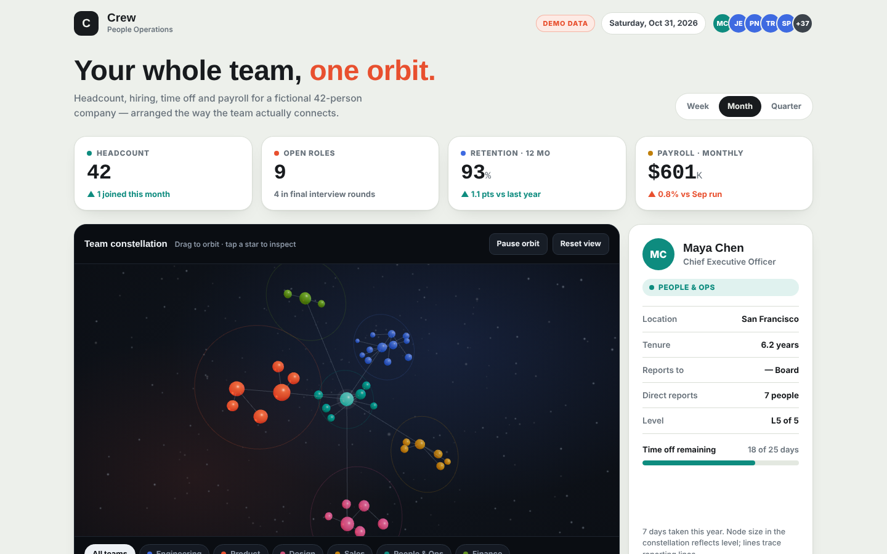

# Crew People Ops: KPI layer in SQL

A people-operations dashboard whose numbers are computed, not typed. The visual concept (layout and 3D "team constellation") came from a Muse template; this repository adds the data layer behind it: a relational schema, SQL for every KPI, data-quality checks, and three insights.

**Everything here is synthetic.** The 42 employees, candidates and payroll amounts are fictional. This is a method demonstration, not a real result.



## Open it
Open `index.html` in a browser (no server needed). Drag the constellation, switch Week / Month / Quarter, toggle Monthly / Annual payroll.

## What was added to the template
| Muse template | Added in this repository |
|---|---|
| Page layout, styling, 3D constellation, names and roles | Schema (7 tables, primary and foreign keys) |
| KPI numbers typed into the page | Seeded synthetic data: employees, leave, requisitions, candidates, payroll runs |
| | SQL for every KPI, including window functions (median, LAG, running share, gaps-and-islands) |
| | 10 data-quality checks plus a negative test with injected errors |
| | Pandas cross-check of headcount, retention, payroll and median time-to-offer |
| | Three SQL-based insights and the build step that writes `index.html` |

The schema, data generator, SQL, checks and wiring were written AI-assisted and reviewed by the author.

## Files
- `01_crew_people_ops_kpi.ipynb`: the whole pipeline with outputs. Run top to bottom.
- `METHODOLOGY.md`: KPI definitions, assumptions, limitations.
- `dashboard_template.html`: the original Muse template (input to the notebook).
- `index.html`: the dashboard after the notebook replaces every KPI with a computed value.
- `data/`: the tables as CSV and `kpis.json`.

## Run it
Python 3.10+, `pandas` and Jupyter. SQLite ships with Python.
```
pip install pandas jupyter
jupyter notebook 01_crew_people_ops_kpi.ipynb
```
Keep `dashboard_template.html` next to the notebook. The notebook writes `data/` and `index.html`.

## Findings that motivated this
Checking the template showed that several figures could not be derived from its own data: "3 joined this month" (the data had no such joiners), "38 active candidates" (included two already hired), and retention and time-to-offer (no departure or stage dates existed). The notebook creates the missing data and computes each one.

## Limitations
- Synthetic data, one fictional company, 42 people. Small samples (for example 1 to 4 offers per department) make department comparisons directional only.
- Benefits and tax rates are simplified assumptions, not real payroll rules.
- No production deployment, real users or business impact.
